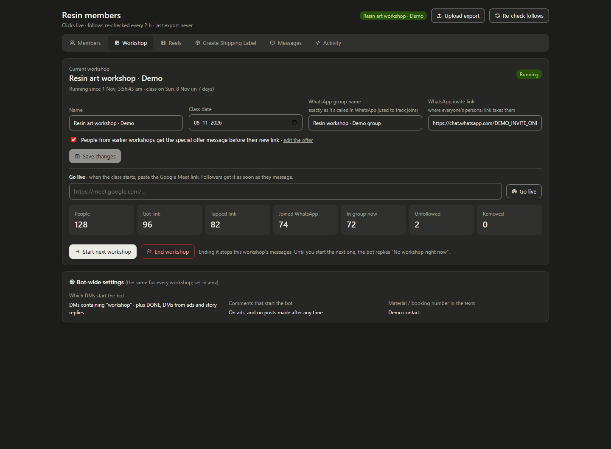
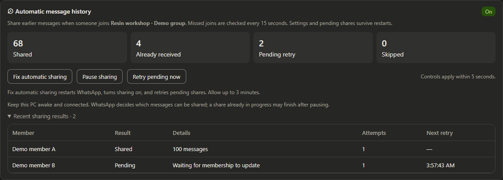
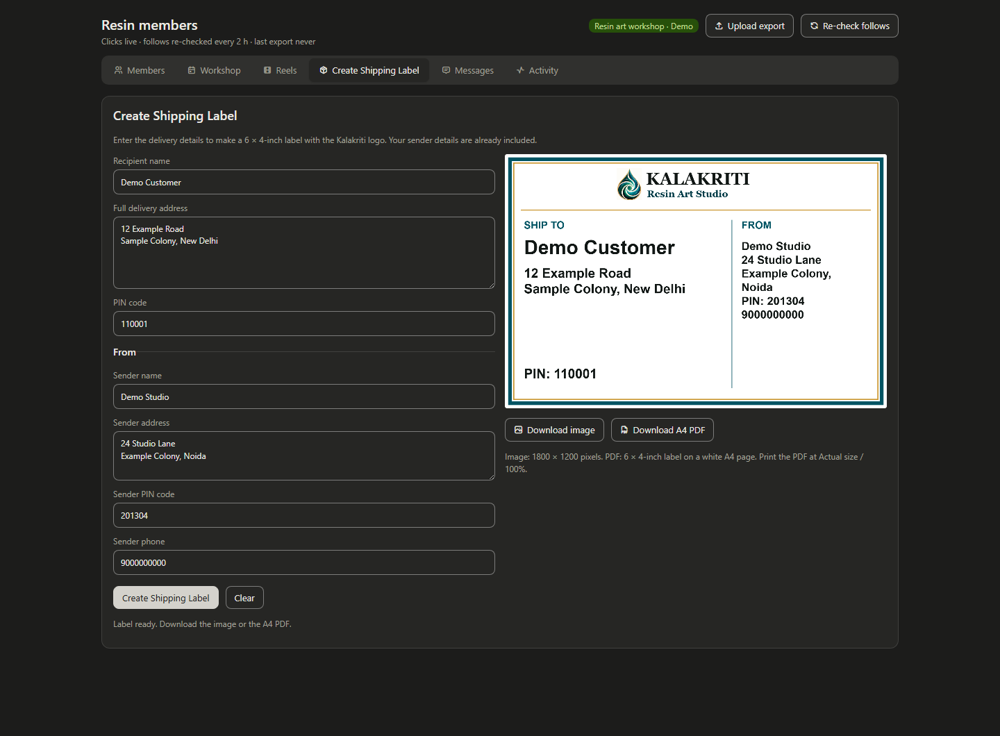

# Meta ecosystem workshop bot

A workshop operations app built for Kalakriti Resin Art Studio. It handles Instagram and Facebook enquiries, sends personal workshop links, tracks WhatsApp joins, and gives the team a local dashboard for running each batch.

The project also includes a Meta Ads Manager, a separate WhatsApp enquiry inbox, and a shipping-label maker for workshop kits. The backend uses Python, FastAPI and SQLite; WhatsApp connections use Node.js and whatsapp-web.js.

## Screenshots

These are captures of the actual dashboard with sample data. Names, addresses, invite links and counts in these screenshots are for demonstration.

### Workshop dashboard

Manage the current batch, change its group and invite link, go live with a class link, and see how many people reached each step.



### Automatic WhatsApp history sharing

See completed shares and pending retries. Pause or resume sharing, retry pending jobs, or use **Fix automatic sharing** to reconnect WhatsApp and check missed joins.



### Shipping labels

Enter delivery details, edit the sender details, and preview a branded 6 × 4-inch label. Download a 1800 × 1200 PNG or an A4 PDF; print the PDF at **Actual size / 100%**.



## What it does

- **Instagram enquiries:** replies to eligible comments, ad DMs and story replies; checks whether someone follows the account before sending their workshop link.
- **Facebook Messenger:** uses the workshop's messages and personal links. Facebook Page follow confirmation is trusted because the app cannot check Page follows.
- **Member tracking:** records personal-link taps, watches WhatsApp joins and leaves, suggests matches between accounts and numbers, and flags unfollowers for manual review and removal.
- **Workshop management:** keeps separate batches and their history, runs a setup wizard for the next workshop, and switches messages when a live-class link is set.
- **Message editing:** lets the team edit bot replies and FAQ keywords, preview messages, and try sample questions. Reels can have separate offers, and selected posts can be bypassed.
- **WhatsApp history:** stores pending shares on disk, checks missed joins, and retries failures with backoff. The dashboard shows the queue and connection status.
- **Ads:** creates campaigns and creatives, shows performance, and changes budgets, dates and status. It can also add a creative to an existing Instagram DM conversation ad set using that ad set's delivery settings. New ads start paused.
- **WhatsApp enquiry inbox:** a separate local, rule-based FAQ bot with payment review, team handoff, per-chat pauses and an inbox. See [its README](wa_dm/README.md) for setup and behaviour.
- **Shipping:** renders labels in the browser using the included logo, without sending delivery details to an external service. Clearing the form keeps the sender details.

## Local setup

The launchers and supervisors are built for Windows. You'll need Python, Node.js with npm, Meta professional-account and app credentials, and a WhatsApp admin account that can be linked as a device. The group listener uses Microsoft Edge by default; `WA_BROWSER` can point to another Chromium browser executable.

From the repository root in PowerShell:

```powershell
python -m venv .venv
.\.venv\Scripts\python.exe -m pip install -r requirements.txt
npm --prefix wa ci
Copy-Item .env.example .env
```

Run the copy command only on a fresh checkout; keep an existing `.env` file. Fill in `VERIFY_TOKEN`, `APP_SECRET`, `IG_ACCESS_TOKEN` and `IG_USER_ID`. Set `WORKSHOP_LINK` for the initial workshop and adjust `KEYWORD`, `START_AFTER` and `CONTACT_NUMBER` as needed.

| Optional feature | Configuration |
| --- | --- |
| Facebook Messenger | `PAGE_ID`, `PAGE_ACCESS_TOKEN`, `FB_APP_SECRET` in the root `.env` |
| Initial workshop | `WORKSHOP_SINCE`, `WA_MAIN_CHAT`, `MEET_URL`, `WORKSHOP_LINK` in the root `.env` |
| Permanent personal-link address | `PUBLIC_LINK_BASE` pointing to the configured public bot host |
| Separate public join service | `JOIN_SERVICE_BASE` and `JOIN_SYNC_TOKEN`; see [domain setup](JOIN_DOMAIN_SETUP.md) |
| Ads Manager | `META_ACCESS_TOKEN`, `AD_ACCOUNT_ID`, `PAGE_ID`, `IG_ACCOUNT_ID` in `ads/.env` |

Once workshops have been created, change their group, invite link and live-class settings in the dashboard's **Workshop** tab. These values are stored in `bot.db`; changing the initial values in `.env` does not update an existing workshop.

Start the webhook server:

```powershell
.\.venv\Scripts\python.exe -m uvicorn main:app --host 127.0.0.1 --port 8000
```

Configure a public HTTPS tunnel or host for port 8000, then register its `/webhook` URL in the Meta app with your verification token. The server handles both Instagram and configured Facebook Page events. Account access, subscriptions and permissions must also be configured in Meta.

Open another terminal for the dashboard:

```powershell
.\start_dashboard.bat
```

This starts the dashboard and WhatsApp group-listener supervisor. Open the dashboard, scan the linked-device QR code with the admin phone, and configure the workshop group. The computer must stay awake, online and linked for local automation to work.

| Service | Local address | Start |
| --- | --- | --- |
| Webhook and personal-link redirects | `http://127.0.0.1:8000` | Webhook command above |
| Members and workshop dashboard | `http://127.0.0.1:8001` | `start_dashboard.bat` |
| Meta Ads Manager | `http://127.0.0.1:8002` | `ads/start_admanager.bat` |
| WhatsApp enquiry inbox | `http://127.0.0.1:8003` | `start_whatsapp_bot.bat` |

The enquiry inbox needs the additional dependencies in `wa_dm/requirements.txt`. It uses its own WhatsApp session and database; follow [its setup instructions](wa_dm/README.md) before turning replies on.

Keep the management dashboards on loopback. Only the webhook service should be exposed through the public tunnel.

## History sharing and recovery

`members_keepalive.py` supervises the members dashboard and WhatsApp listener. Join events request an immediate history share; membership reconciliation every 15 seconds catches joins WhatsApp did not emit as events, including eligible joins missed during downtime.

Pending jobs live in `wa/history-jobs.json` and survive restarts. Retry delays increase up to five minutes. **Pause sharing** keeps pending jobs; a share already in progress may finish. WhatsApp's eligibility window and already-received checks still apply, so a connected listener cannot guarantee every joiner receives history.

If sharing stalls, open **Members → Automatic message history → Fix automatic sharing**. It resumes sharing, restarts the listener and requests another check of pending shares. Allow up to three minutes. If the card asks you to link WhatsApp again, scan the QR code on the WhatsApp card.

## Project layout

| Path | Purpose |
| --- | --- |
| `main.py`, `messenger.py` | Meta webhooks, reply flows and personal links |
| `dashboard.py`, `dashboard.html` | Local dashboard and management API |
| `bot_messages.py` | Message catalogue and editing rules |
| `members_keepalive.py`, `wa/listener.js` | Supervision, group events and history sharing |
| `wa/history_queue.js` | Persistent history queue and retries |
| `shipping-label.js`, `assets/shipping-logo.jpeg` | Browser label renderer and studio logo |
| `ads/` | Local Meta Ads Manager and campaign assets |
| `wa_dm/` | Separate WhatsApp enquiry bot and inbox |
| `join-service/`, `join_sync.py` | Public join page and durable click synchronisation |
| `reel/` | Promo-reel composition and rendering scripts |
| `docs/screenshots/` | Sample-data screenshots used in this README |

[DASHBOARD_FEATURES.md](DASHBOARD_FEATURES.md) contains the original dashboard design notes. [wa_dm/FAQ.md](wa_dm/FAQ.md) lists enquiry examples.

## Checks and screenshots

Run the focused history-recovery, bypass and queue tests:

```powershell
.\.venv\Scripts\python.exe -m unittest test_history_dashboard test_bypass
node --test wa/history_queue.test.js
```

To refresh the README screenshots after installing the `wa/` dependencies:

```powershell
node docs/capture-screenshots.cjs
```

The capture script loads the real dashboard with synthetic API responses. It does not contact the running bot or use customer records. It also checks label rendering, download invalidation after edits, and sender preservation when clearing the form. Set `SCREENSHOT_BROWSER` to a Chrome or Edge executable if Puppeteer's bundled browser is unavailable.

Credentials, databases, WhatsApp sessions, customer exports and runtime logs belong outside version control. Keep local ad audits and delivery-label exports out of public commits as well.
